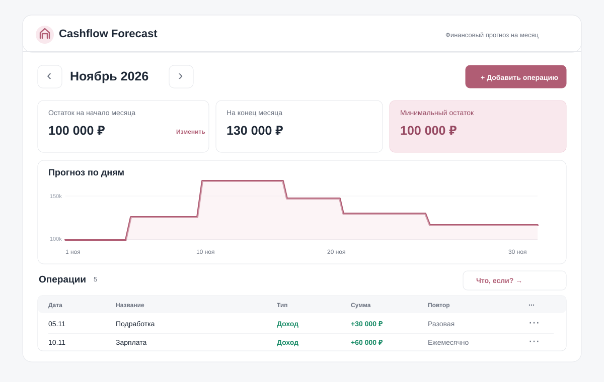

# UI Reference — Cashflow Forecast

Это **визуальный ориентир**, не готовая реализация. Все названия компонентов и поля, приведённые ниже, специально зафиксированы, чтобы отдельные маленькие задачи не требовали заново придумывать интерфейс.

## 1. Настроение и палитра

Светлый, спокойный интерфейс персонального финансового планировщика. Без тяжёлой админки, тёмного сайдбара, аватарок, настроек, отдельных страниц и лишних переключателей. **В MVP всего один основной экран + формы-модалки + режим эксперимента на том же экране.** Скриншот — пример расположения, а не требование к пиксельной точности.

| Применение | Цвет | HEX |
| --- | --- | --- |
| Фон всей страницы | очень светлый серый | `#F6F7F9` |
| Карточки и модалки | белый | `#FFFFFF` |
| Основной текст | графит | `#1F2937` |
| Дополнительный текст | серый | `#6B7280` |
| Граница | нейтральный серый | `#E5E7EB` |
| Основная кнопка, акцент | приглушённый ягодный | `#B05D74` |
| Hover на кнопке | ягодный темнее | `#974962` |
| Светлая акцентная подложка | нежно-розовый | `#F9E8ED` |
| Доход, успех | зелёный | `#168A65` |
| Расход, ошибка | красный | `#DC4757` |
| Информация | синий | `#3B82F6` |

Шрифт: системный sans-serif (например, Inter с системным запасным шрифтом; внешний шрифт необязателен). Размеры: H1 28px/700; заголовок карточки 16px/600; основной текст 14px; подпись 12px. Радиусы 12–16px; отступы между блоками 16–24px; фокус на поле/кнопке должен быть заметен.

## 2. Точный состав главного экрана

**Не добавлять отдельные страницы и меню в MVP.**

Порядок сверху вниз:

1. `AppHeader` — логотип/название слева, подпись «Финансовый прогноз на месяц» справа/под ним.
2. `MonthSwitcher` — кнопка «Назад», название текущего месяца («Ноябрь 2026»), кнопка «Вперёд».
3. `OpeningBalanceCard` — «Остаток на начало месяца», сумма или «Не указан», действие «Изменить».
4. `ForecastSummary` — две карточки: «На конец месяца» и «Минимальный остаток»; предупреждение про отрицательные дни, если оно есть.
5. `ForecastChart` — остаток на конец каждого дня; над графиком название «Прогноз по дням».
6. `OperationsSection` — заголовок «Операции», счётчик, кнопка «Добавить операцию»; ниже `OperationsList` со столбцами «Дата / Название / Тип / Сумма / Повтор / Действия».
7. `ScenarioToolbar` — кнопка «Что, если?» в обычном режиме. В эксперименте вместо неё надпись «Эксперимент (изменения не сохранены)» и кнопки «Сбросить» / «Применить».
8. `TransactionDialog` — модальная форма создания/редактирования; режим разовой операции или ежемесячного правила. Не показывать обе формы одновременно.

В эксперименте не нужна новая страница: `ForecastSummary` показывает две группы сумм, `ForecastChart` — две линии (основная и альтернативная), `OperationsList` позволяет редактировать **локальную копию**.

## 3. Поведение на мобильном

- При 375px все блоки выстроены вертикально, боковой прокрутки страницы нет.
- Столбцы списка заменяются карточками: дата и тип сверху, название и сумма ниже, действия в конце карточки.
- У форм полная доступная ширина, кнопки сохранять/отменить не обрезаются.
- График помещается по ширине; детали дня доступны через фокус/нажатие, не только hover.

## 4. Данные для отображения в макете (все вымышленные)

Выбранный месяц: ноябрь 2026. Начальный остаток: **100 000 ₽**.

| Дата | Название | Тип | Сумма | Повтор |
| --- | --- | --- | --- | --- |
| 05.11 | Подработка | Доход | +30 000 ₽ | Разовая |
| 10.11 | Зарплата | Доход | +60 000 ₽ | Ежемесячно |
| 15.11 | Аренда | Расход | −25 000 ₽ | Ежемесячно |
| 18.11 | Покупка | Расход | −20 000 ₽ | Разовая |
| 30.11 | Кредит | Расход | −15 000 ₽ | Ежемесячно |

Расчёт из этих примеров: остаток на конец месяца 130 000 ₽; минимальный остаток за календарный месяц **100 000 ₽**. Изображение UI — композиционный эскиз, а не скриншот работающего расчёта.

## 5. Компоненты и ответственность

| Компонент | Что принимает / делает | Где реализовать |
| --- | --- | --- |
| `AppHeader` | только статичные заголовки | `client/src/components/AppHeader.tsx` |
| `MonthSwitcher` | `month`, `onPrevious`, `onNext` | `client/src/features/plan/MonthSwitcher.tsx` |
| `OpeningBalanceCard` | `value: number|null`, `onEdit`, `isSaving` | `client/src/features/plan/OpeningBalanceCard.tsx` |
| `OpeningBalanceDialog` | `value`, `onSave`, `onClose` | `client/src/features/plan/OpeningBalanceDialog.tsx` |
| `SummaryCard` | `label`, `value`, `tone` | `client/src/components/SummaryCard.tsx` |
| `ForecastSummary` | показатели прогноза и предупреждения | `client/src/features/forecast/ForecastSummary.tsx` |
| `ForecastChart` | массив дневных остатков и, при необходимости, второй массив | `client/src/features/forecast/ForecastChart.tsx` |
| `OperationsList` | `operations`, `onEdit`, `onDelete` | `client/src/features/operations/OperationsList.tsx` |
| `TransactionDialog` | `mode`, `initialValue`, `onSubmit`, `onClose` | `client/src/features/operations/TransactionDialog.tsx` |
| `ScenarioToolbar` | `isActive`, `onStart`, `onReset`, `onApply` | `client/src/features/scenario/ScenarioToolbar.tsx` |

Пути указаны как **рекомендуемые конкретные места**, чтобы ты не тратила время на поиск файла. Можно поменять позже при рефакторинге.

## 6. Где смотреть API

**Единственный контракт:** [docs/API.md](./API.md). URL, JSON, серверные ошибки и `revision` определены там, не придумываются по ходу разработки.
